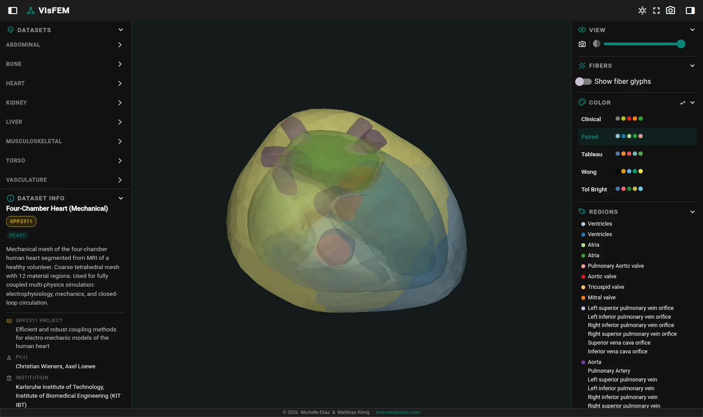

# VisFEM: Web visualization of FEM models
[](https://github.com/matthiaskoenig/visfem/actions/workflows/ci-cd.yml) [](https://visfem.de/docs/) [](https://pypi.org/project/visfem/) [](https://pypi.org/project/visfem/) [](https://opensource.org/licenses/MIT) [](https://doi.org/10.5281/zenodo.19220183)

VisFEM is an interactive web app for visualizing Finite Element Method (FEM) simulation results, with a focus on biomedical applications. It runs in the browser on top of [trame](https://kitware.github.io/trame/), [PyVista](https://pyvista.org/) and [VTK](https://vtk.org/): the meshes are loaded and prepared on the server, the browser renders them with vtk.js. The source code is available from [https://github.com/matthiaskoenig/visfem](https://github.com/matthiaskoenig/visfem), the public instance runs at [app.visfem.de](https://app.visfem.de).



## Features

- **[Datasets](datasets.md)** - a dataset is a folder of mesh files plus a JSON descriptor with its scientific context: principal investigator, institution, organ system, references. VisFEM discovers every dataset of a data directory and groups them by organ system.
- **[Renderers](renderers.md)** - seven built-in renderers cover static surfaces, multi-part geometries, region-coloured meshes with fibre glyphs, scalar fields and time series from XDMF, PVD, VTK series or LS-DYNA d3plot files.
- **Mesh formats** - everything [meshio](https://github.com/nschloe/meshio) and PyVista read, e.g., VTK, VTU, STL, OBJ, PLY, XDMF+HDF5, PVD, plus FEBio 2.x models and LS-DYNA d3plot databases.
- **Interaction** - categorical palettes and continuous colormaps, opacity, region legends, playback of time series, screenshots, a light and a dark theme, and WebXR for viewing a model in virtual reality.
- **[Command line](usage.md)** - `visfem` launches the app and scaffolds, documents and validates datasets.
- **[Example data](example-data.md)** - `visfem fetch-ircadb` and `visfem fetch-openknee` download two public datasets ready to view.

## Quickstart

```bash
pip install visfem
visfem
```

The app opens in the browser. Point `DATA_DIR` at a data directory to view your own datasets, see [Running the app](usage.md).

## How to cite

[](https://doi.org/10.5281/zenodo.19220183)

If you use VisFEM, please cite the software repository:

> Elias, M. & König, M. (2026). *VisFEM: Web visualization of FEM models.* Zenodo. [https://doi.org/10.5281/zenodo.19220183](https://doi.org/10.5281/zenodo.19220183)

The citation information is also available in the [CITATION.cff](https://github.com/matthiaskoenig/visfem/blob/develop/CITATION.cff) of the repository.

## License

- Source code: [MIT](https://opensource.org/license/MIT)
- Documentation: [CC BY-SA 4.0](http://creativecommons.org/licenses/by-sa/4.0/)

The example datasets keep the licenses of their providers, see [Example data](example-data.md).

The software ships as is; the MIT license in `LICENSE` disclaims all warranties, including merchantability and fitness for a particular purpose.

## Funding

The German Research Foundation (DFG) supports Matthias König within the Research Unit Programme FOR 5151 "QuaLiPerF (Quantifying Liver Perfusion-Function Relationship in Complex Resection - A Systems Medicine Approach)" by grant number 436883643 and by grant number 465194077 (Priority Programme SPP2311, Subproject SimLivA).

The Federal Ministry of Education and Research (BMBF, Germany) supported Matthias König within the research network Systems Medicine of the Liver (LiSyM, grant number 031L0054).

The German Research Foundation (DFG) supports Michelle Elias under grant number 465194077 (Priority Programme SPP2311).

&copy; 2026 Michelle Elias & Matthias König
